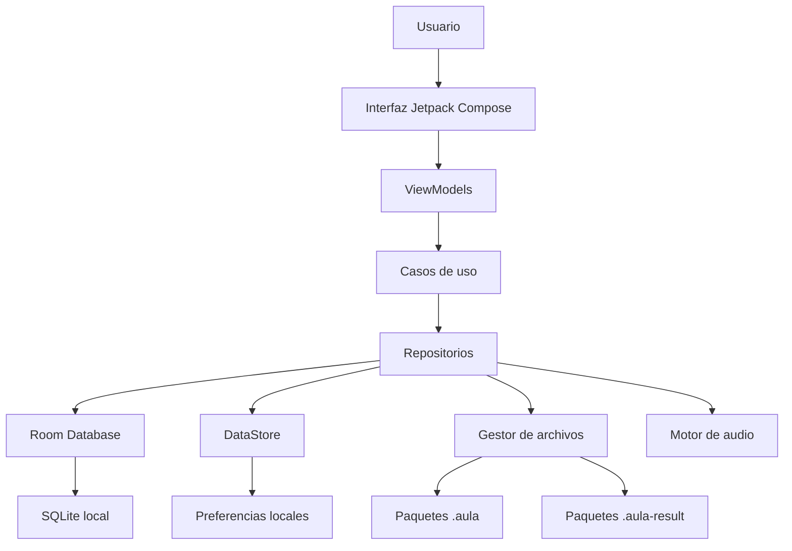
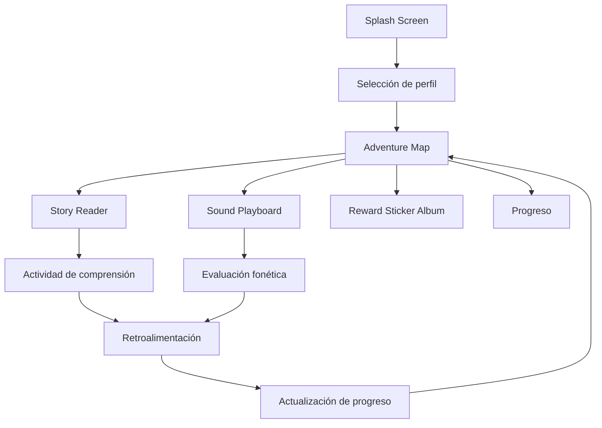
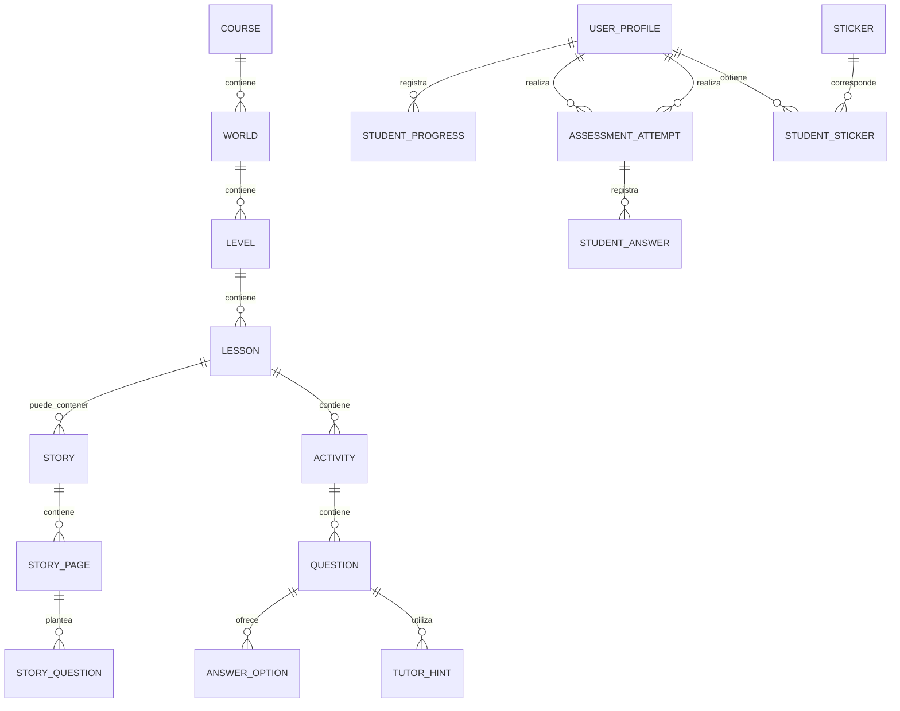
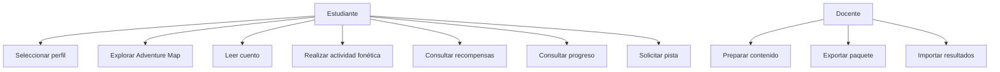

# Documentación técnica — AulaNexo

**Proyecto:** AulaNexo
**Tipo:** Aplicación móvil educativa Android  
**Enfoque:** Aprendizaje temprano de fonética inglesa (*Early Learning Phonics*)  
**Arquitectura:** Offline First  
**Plataforma:** Android  
**Tecnologías principales:** Kotlin, Jetpack Compose, Material 3, Room y DataStore  
**Versión documental:** 1.0  
**Estado:** Propuesta inicial para desarrollo

---

# Índice de documentos

1. `01_requerimientos.md`
2. `02_arquitectura_software.md`
3. `03_modelo_datos.md`
4. `04_casos_de_uso.md`
5. `05_especificacion_paquetes_offline.md`
6. `06_plan_pruebas.md`
7. `07_plan_desarrollo_y_configuracion.md`

---

# 01_requerimientos.md

# Especificación de Requerimientos de Software

## 1. Introducción

### 1.1. Propósito

Este documento define los requerimientos funcionales y no funcionales de AulaNexo, una aplicación móvil educativa diseñada para ayudar a niños a desarrollar habilidades iniciales de lectura y reconocimiento fonético del idioma inglés.

La aplicación permitirá aprender mediante cuentos interactivos, reconocimiento de sonidos, combinación de letras, actividades educativas y recompensas visuales.

### 1.2. Descripción del problema

Los niños que se encuentran en las primeras etapas de aprendizaje necesitan recursos didácticos que permitan practicar la relación entre letras, sonidos y palabras.

Sin embargo, muchas aplicaciones educativas dependen de una conexión permanente a Internet, lo que limita su utilización en instituciones educativas y comunidades con conectividad reducida.

AulaNexo propone una experiencia educativa que pueda utilizarse sin conexión, almacenando localmente los contenidos, actividades y avances del estudiante.

### 1.3. Objetivo general

Desarrollar una aplicación Android educativa que facilite el aprendizaje inicial de la fonética inglesa mediante actividades interactivas, contenidos multimedia y mecanismos de retroalimentación progresiva, garantizando su funcionamiento sin conexión a Internet.

### 1.4. Objetivos específicos

- Presentar cuentos educativos adaptados al nivel del estudiante.
- Facilitar la identificación y pronunciación de sonidos.
- Enseñar la combinación de letras para formar palabras.
- Incorporar actividades de comprensión lectora.
- Motivar el aprendizaje mediante recompensas visuales.
- Registrar el progreso individual de cada estudiante.
- Permitir el acceso a los contenidos sin conexión.
- Proporcionar pistas graduales sin revelar directamente las respuestas.

## 2. Alcance

### 2.1. Funcionalidades incluidas

- Gestión de perfiles locales.
- Selección de perfil de estudiante.
- Visualización de contenidos educativos.
- Lectura interactiva de cuentos.
- Reproducción de sonidos y palabras.
- Actividades de reconocimiento fonético.
- Combinación de letras.
- Preguntas de comprensión.
- Sistema de pistas educativas.
- Mapa de progreso.
- Colección de stickers y recompensas.
- Registro del progreso.
- Importación y exportación de contenidos.
- Exportación de resultados.
- Funcionamiento sin Internet.

### 2.2. Funcionalidades fuera del alcance inicial

- Clases virtuales en tiempo real.
- Videollamadas.
- Chat entre estudiantes.
- Red social educativa.
- Reconocimiento automático de pronunciación mediante servicios externos.
- Generación de contenidos mediante inteligencia artificial en tiempo real.
- Sincronización obligatoria con servidores.
- Pagos y suscripciones.
- Publicidad.

Estas funcionalidades podrán evaluarse en futuras versiones.

## 3. Usuarios del sistema

### 3.1. Estudiante

Usuario principal de la aplicación.

Puede:

- Acceder a sus cuentos.
- Explorar el mapa de aventuras.
- Realizar actividades fonéticas.
- Resolver preguntas.
- Consultar sus recompensas.
- Revisar su progreso.

### 3.2. Docente o administrador de contenidos

Usuario responsable de preparar y distribuir los recursos educativos.

Puede:

- Organizar cursos o colecciones.
- Incorporar cuentos.
- Crear actividades.
- Registrar preguntas y respuestas.
- Configurar pistas.
- Exportar paquetes educativos.
- Consultar resultados importados.

### 3.3. Consideraciones sobre perfiles infantiles

La aplicación debe contemplar el uso compartido de dispositivos.

Cada estudiante tendrá un perfil local independiente. La selección de un perfil no debe considerarse un mecanismo de autenticación de alta seguridad.

No se deben solicitar datos personales innecesarios de menores.

## 4. Requerimientos funcionales

### 4.1. Gestión de perfiles

| Código | Requerimiento | Prioridad |
|---|---|---|
| RF-001 | El sistema permitirá crear perfiles de estudiantes. | Alta |
| RF-002 | El sistema permitirá seleccionar un perfil existente. | Alta |
| RF-003 | El sistema permitirá editar el nombre visible y avatar del perfil. | Media |
| RF-004 | El sistema mantendrá los avances separados por estudiante. | Alta |
| RF-005 | El sistema permitirá cambiar de perfil. | Alta |

### 4.2. Adventure Map

| Código | Requerimiento | Prioridad |
|---|---|---|
| RF-006 | El sistema mostrará un mapa de progreso educativo. | Alta |
| RF-007 | Los contenidos estarán organizados por mundos o niveles. | Alta |
| RF-008 | El sistema mostrará el estado de cada nivel. | Alta |
| RF-009 | El sistema mostrará el progreso del estudiante. | Alta |
| RF-010 | El sistema permitirá ingresar a los niveles disponibles. | Alta |
| RF-011 | El sistema podrá mostrar objetivos diarios. | Media |

### 4.3. Story Reader

| Código | Requerimiento | Prioridad |
|---|---|---|
| RF-012 | El sistema mostrará cuentos divididos en páginas. | Alta |
| RF-013 | Cada cuento tendrá título, nivel e ilustraciones. | Alta |
| RF-014 | El sistema permitirá avanzar y retroceder entre páginas. | Alta |
| RF-015 | El sistema permitirá reproducir la narración de una página. | Alta |
| RF-016 | El sistema permitirá reproducir palabras individualmente. | Alta |
| RF-017 | El sistema permitirá utilizar una modalidad de pronunciación lenta. | Media |
| RF-018 | El sistema permitirá repetir sonidos y narraciones. | Alta |
| RF-019 | El sistema permitirá seleccionar palabras interactivas. | Alta |
| RF-020 | El sistema permitirá responder preguntas relacionadas con el cuento. | Alta |
| RF-021 | El sistema registrará el avance de lectura. | Alta |

### 4.4. Sound Playboard

| Código | Requerimiento | Prioridad |
|---|---|---|
| RF-022 | El sistema mostrará actividades de combinación de letras. | Alta |
| RF-023 | El estudiante podrá formar palabras utilizando bloques de letras. | Alta |
| RF-024 | El sistema reproducirá sonidos asociados a las letras. | Alta |
| RF-025 | El sistema permitirá escuchar la pronunciación de palabras completas. | Alta |
| RF-026 | El sistema proporcionará retroalimentación sobre las respuestas. | Alta |
| RF-027 | El sistema registrará los resultados de las actividades. | Alta |

### 4.5. Tutor educativo

| Código | Requerimiento | Prioridad |
|---|---|---|
| RF-028 | El sistema ofrecerá pistas progresivas. | Alta |
| RF-029 | Las pistas se presentarán en un orden definido. | Alta |
| RF-030 | El sistema evitará revelar directamente la respuesta en la primera interacción. | Alta |
| RF-031 | El sistema permitirá solicitar una pista adicional. | Alta |
| RF-032 | El sistema indicará cuando no disponga de información suficiente para orientar al estudiante. | Media |
| RF-033 | El sistema registrará el uso de pistas durante las actividades. | Media |

**Regla pedagógica:** el tutor debe orientar mediante preguntas, ejemplos parciales y pistas. No debe limitarse a mostrar la solución correcta.

La primera versión utilizará reglas y pistas previamente preparadas por el docente. No dependerá de un modelo de inteligencia artificial ni de Internet.

### 4.6. Reward Sticker Album

| Código | Requerimiento | Prioridad |
|---|---|---|
| RF-034 | El sistema tendrá un álbum de stickers. | Alta |
| RF-035 | Los stickers estarán organizados por categorías. | Alta |
| RF-036 | El sistema distinguirá stickers obtenidos y pendientes. | Alta |
| RF-037 | El sistema entregará recompensas al cumplir determinados objetivos. | Alta |
| RF-038 | El sistema permitirá consultar las recompensas obtenidas. | Alta |

Categorías iniciales:

- Cosmic Cat.
- Sunny Sun.
- Bouncing Bear.

### 4.7. Gestión de contenidos

| Código | Requerimiento | Prioridad |
|---|---|---|
| RF-039 | El sistema permitirá importar paquetes educativos. | Alta |
| RF-040 | El sistema validará la estructura de los paquetes importados. | Alta |
| RF-041 | El sistema permitirá exportar contenidos educativos. | Alta |
| RF-042 | El sistema permitirá exportar resultados del estudiante. | Alta |
| RF-043 | El sistema conservará los contenidos importados localmente. | Alta |
| RF-044 | El sistema identificará versiones de contenidos. | Alta |

### 4.8. Progreso y resultados

| Código | Requerimiento | Prioridad |
|---|---|---|
| RF-045 | El sistema registrará actividades completadas. | Alta |
| RF-046 | El sistema almacenará respuestas y puntuaciones. | Alta |
| RF-047 | El sistema mostrará el progreso por mundo y nivel. | Alta |
| RF-048 | El sistema conservará los resultados al cerrar la aplicación. | Alta |
| RF-049 | El sistema permitirá exportar el progreso para su recuperación o revisión. | Alta |

## 5. Requerimientos no funcionales

### 5.1. Rendimiento

- RNF-001: La navegación entre pantallas deberá ser fluida.
- RNF-002: Las consultas locales deberán ejecutarse sin bloqueos de la interfaz.
- RNF-003: Los recursos multimedia deberán cargarse de manera eficiente.
- RNF-004: Las operaciones de importación y exportación deberán ejecutarse fuera del hilo principal.

### 5.2. Disponibilidad offline

- RNF-005: Las funcionalidades educativas principales deberán funcionar sin Internet.
- RNF-006: Los contenidos importados deberán permanecer disponibles localmente.
- RNF-007: El progreso deberá almacenarse en el dispositivo.
- RNF-008: La aplicación no deberá requerir autenticación en línea para acceder a los contenidos locales.

### 5.3. Usabilidad y accesibilidad

- RNF-009: La interfaz utilizará botones grandes y fáciles de identificar.
- RNF-010: Los elementos interactivos tendrán áreas táctiles adecuadas.
- RNF-011: Se utilizarán textos claros y legibles.
- RNF-012: Los colores no serán el único medio para comunicar estados.
- RNF-013: Los mensajes de error estarán redactados de manera comprensible.
- RNF-014: La aplicación deberá contemplar lectores de pantalla y escalado de texto.

### 5.4. Seguridad y privacidad

- RNF-015: Los datos se almacenarán localmente.
- RNF-016: La aplicación minimizará la recopilación de datos personales.
- RNF-017: Los paquetes importados serán validados antes de procesarse.
- RNF-018: Los archivos multimedia no podrán ejecutar código.
- RNF-019: Se evitará exponer información personal en los paquetes exportados.

### 5.5. Mantenibilidad

- RNF-020: El código estará organizado por funcionalidades.
- RNF-021: La interfaz estará desacoplada de la lógica de negocio.
- RNF-022: Las operaciones de persistencia estarán encapsuladas en repositorios.
- RNF-023: Se utilizarán pruebas automatizadas para las funcionalidades principales.

## 6. Reglas de negocio

| Código | Regla |
|---|---|
| RN-001 | Cada estudiante tendrá un identificador local único. |
| RN-002 | Los avances estarán asociados al perfil activo. |
| RN-003 | Un nivel podrá estar bloqueado, disponible o completado. |
| RN-004 | Un estudiante podrá repetir una actividad. |
| RN-005 | Las recompensas no deberán duplicarse por completar repetidamente el mismo objetivo, salvo que la actividad defina recompensas repetibles. |
| RN-006 | Las pistas se mostrarán de forma progresiva. |
| RN-007 | Los contenidos importados deberán superar las validaciones antes de quedar disponibles. |
| RN-008 | Una actualización de contenido no deberá eliminar el progreso del estudiante. |
| RN-009 | El funcionamiento educativo principal no dependerá de conexión a Internet. |
| RN-010 | Los resultados deberán identificar la versión del contenido con la que fueron generados. |

## 7. Criterios generales de aceptación

- El estudiante puede abrir la aplicación sin Internet.
- Puede seleccionar un perfil.
- Puede abrir un cuento previamente almacenado.
- Puede escuchar la narración y sonidos disponibles.
- Puede completar una actividad fonética.
- Puede solicitar pistas.
- Puede obtener recompensas.
- El progreso permanece guardado después de cerrar la aplicación.
- Puede importar un paquete válido.
- Un paquete inválido no altera la información existente.

---

# 02_arquitectura_software.md

# Arquitectura de Software

## 1. Objetivo

Definir la arquitectura técnica de AulaNexo para facilitar su desarrollo, mantenimiento y ampliación.

## 2. Decisiones tecnológicas

| Área | Tecnología |
|---|---|
| Lenguaje | Kotlin |
| Plataforma | Android |
| Interfaz | Jetpack Compose |
| Diseño | Material 3 personalizado |
| Arquitectura | MVVM + Clean Architecture pragmática |
| Persistencia | Room |
| Base de datos | SQLite |
| Preferencias | DataStore |
| Concurrencia | Kotlin Coroutines |
| Estado reactivo | StateFlow |
| Navegación | Navigation Compose |
| Imágenes | Coil |
| Audio | Android Media3 o solución nativa apropiada |
| Inyección de dependencias | Hilt |
| Pruebas | JUnit, MockK y Compose UI Test |

Las versiones de las dependencias deberán verificarse al configurar el proyecto. Claude no deberá inventar versiones ni utilizar APIs inexistentes.

## 3. Principios arquitectónicos

1. Offline First.
2. Separación de responsabilidades.
3. Bajo acoplamiento.
4. Alta cohesión.
5. Persistencia local como fuente principal de información.
6. Componentes reutilizables.
7. Diseño adaptable a diferentes tamaños de pantalla.
8. Seguridad durante la importación de archivos.

## 4. Arquitectura general



## 5. Capas

### 5.1. Presentation

Responsable de mostrar la interfaz y gestionar las interacciones del usuario.

Componentes:

- Screens.
- Composables.
- ViewModels.
- UI State.
- UI Events.
- Navigation.

Ejemplo:

```kotlin
data class StoryReaderUiState(
    val title: String = "",
    val currentPage: Int = 0,
    val totalPages: Int = 0,
    val isPlaying: Boolean = false,
    val isLoading: Boolean = false
)
```

### 5.2. Domain

Contiene la lógica de negocio independiente de Android.

Componentes:

- Entidades de dominio.
- Interfaces de repositorios.
- Casos de uso.
- Reglas educativas.
- Evaluación de respuestas.
- Gestión de recompensas.
- Lógica de pistas.

Ejemplos de casos de uso:

- `GetAvailableCoursesUseCase`
- `GetStoryByIdUseCase`
- `SaveLessonProgressUseCase`
- `SubmitAssessmentAnswerUseCase`
- `GetNextTutorHintUseCase`
- `AwardStickerUseCase`
- `ImportCoursePackageUseCase`
- `ExportStudentResultsUseCase`

### 5.3. Data

Responsable del almacenamiento y recuperación de información.

Componentes:

- Room Database.
- DAO.
- Entidades Room.
- Mappers.
- Repositorios.
- DataStore.
- Importadores y exportadores.

### 5.4. Core

Contiene funcionalidades compartidas:

- Gestión de errores.
- Constantes.
- Utilidades.
- Componentes de diseño.
- Validaciones comunes.
- Configuración de audio.

## 6. Organización de módulos

Para el MVP se recomienda comenzar con un único módulo Android y paquetes internos bien separados. La división en múltiples módulos Gradle podrá realizarse cuando el proyecto crezca.

Estructura propuesta:

```text
com.aulanexo.sunshinephonics/
│
├── core/
│   ├── common/
│   ├── designsystem/
│   ├── database/
│   ├── datastore/
│   ├── navigation/
│   ├── audio/
│   └── filemanager/
│
├── data/
│   ├── local/
│   │   ├── dao/
│   │   ├── entities/
│   │   └── database/
│   ├── mapper/
│   └── repository/
│
├── domain/
│   ├── model/
│   ├── repository/
│   └── usecase/
│
├── feature/
│   ├── profile/
│   ├── adventure/
│   ├── story/
│   ├── playboard/
│   ├── rewards/
│   ├── tutor/
│   ├── progress/
│   └── contentmanagement/
│
└── MainActivity.kt
```

## 7. Diseño visual y Design System

El diseño proporcionado será la referencia visual del sistema.

### 7.1. Paleta de colores

| Token | Color | Uso |
|---|---|---|
| brand_primary | `#FF5252` | Acciones principales |
| brand_secondary | `#FFC107` | Destacados y audio |
| brand_accent | `#00A0E9` | Elementos interactivos |
| bg_app | `#FFFDF0` | Fondo general |
| card_bg_white | `#FFFFFF` | Tarjetas |
| card_bg_warm | `#FAF6E8` | Superficies secundarias |
| text_primary | `#2C2C2C` | Texto principal |
| text_secondary | `#78909C` | Texto secundario |
| shadow_color | `#E0D7C6` | Sombras |

### 7.2. Estilo

- Soft Rounded.
- Soft Claymorphism.
- Esquinas redondeadas entre 16dp y 24dp.
- Elevaciones suaves.
- Botones tipo pill.
- Ilustraciones infantiles.
- Elementos visuales grandes.
- Animaciones breves y no invasivas.

**Consideración técnica:** Jetpack Compose y Material 3 serán la implementación principal. No se deberán mezclar layouts XML y Compose sin una necesidad justificada. Las sombras deben ser sutiles y no perjudicar el contraste ni la legibilidad.

### 7.3. Tipografía

Se evaluarán:

- Nunito.
- Quicksand.
- Fredoka.

La tipografía elegida deberá integrarse como recurso local para garantizar disponibilidad sin Internet.

### 7.4. Componentes reutilizables

```text
designsystem/
├── components/
│   ├── PrimaryButton.kt
│   ├── SecondaryButton.kt
│   ├── RoundedCard.kt
│   ├── CircularIconButton.kt
│   ├── AudioControl.kt
│   ├── ProgressIndicator.kt
│   ├── LetterBlock.kt
│   ├── StickerCard.kt
│   ├── StoryPageIndicator.kt
│   └── TutorHintCard.kt
│
├── theme/
│   ├── Color.kt
│   ├── Type.kt
│   ├── Shape.kt
│   └── Theme.kt
```

## 8. Navegación

Flujo principal:



## 9. Funcionamiento offline

La aplicación no debe depender de servicios remotos para sus funciones principales.

| Funcionalidad | Dependencia de Internet |
|---|---|
| Abrir perfiles | No |
| Leer cuentos descargados | No |
| Reproducir audios locales | No |
| Resolver actividades | No |
| Consultar recompensas | No |
| Consultar progreso | No |
| Importar paquetes | No |
| Exportar resultados | No |
| Actualizar contenidos desde un servidor | Sí, opcional y futuro |

Los contenidos se almacenarán localmente y estarán disponibles después de cerrar y volver a abrir la aplicación.

## 10. Gestión de audio

El sistema deberá gestionar:

- Narración de cuentos.
- Pronunciación de palabras.
- Sonidos fonéticos.
- Reproducción lenta cuando el recurso lo permita.
- Pausa y reanudación.
- Repetición.
- Liberación de recursos al abandonar la pantalla.

La reproducción lenta podrá implementarse mediante control de velocidad cuando el formato y el reproductor lo permitan. No debe confundirse con una grabación fonética distinta.

## 11. Manejo de errores

Se deberán contemplar:

- Contenido inexistente.
- Archivo multimedia dañado.
- Audio no disponible.
- Error de lectura de base de datos.
- Paquete inválido.
- Versión no compatible.
- Falta de espacio de almacenamiento.
- Perfil inexistente.
- Error durante la importación.

Los errores técnicos deberán registrarse para depuración sin mostrar información interna al estudiante.

---

# 03_modelo_datos.md

# Modelo de Datos

## 1. Objetivo

Definir las entidades y relaciones necesarias para almacenar los contenidos educativos, perfiles, actividades y progreso.

## 2. Modelo conceptual



## 3. Entidades principales

### 3.1. UserProfile

Representa un perfil local de estudiante.

| Campo | Tipo | Descripción |
|---|---|---|
| id | String | Identificador UUID |
| displayName | String | Nombre visible |
| avatarId | String | Identificador del avatar |
| createdAt | Long | Fecha de creación |
| updatedAt | Long | Fecha de modificación |
| isActive | Boolean | Estado del perfil |

### 3.2. Course

Representa una colección de contenidos educativos.

| Campo | Tipo |
|---|---|
| id | String |
| title | String |
| description | String |
| languageCode | String |
| version | Int |
| coverResourceId | String? |
| createdAt | Long |
| updatedAt | Long |
| isPublished | Boolean |

### 3.3. World

Representa un mundo dentro del mapa de aventuras.

| Campo | Tipo |
|---|---|
| id | String |
| courseId | String |
| title | String |
| description | String |
| orderIndex | Int |
| imageResourceId | String? |

Ejemplos:

- Digraph Castle.
- Rhyme Rain.

### 3.4. Level

Representa un nivel de aprendizaje.

| Campo | Tipo |
|---|---|
| id | String |
| worldId | String |
| title | String |
| description | String |
| orderIndex | Int |
| unlockRule | String? |
| difficulty | Int |

### 3.5. Lesson

Representa una lección educativa.

| Campo | Tipo |
|---|---|
| id | String |
| levelId | String |
| title | String |
| description | String |
| orderIndex | Int |
| estimatedMinutes | Int |

### 3.6. Story

Representa un cuento.

| Campo | Tipo |
|---|---|
| id | String |
| lessonId | String |
| title | String |
| readingLevel | String |
| coverResourceId | String? |
| totalPages | Int |

### 3.7. StoryPage

Representa una página del cuento.

| Campo | Tipo |
|---|---|
| id | String |
| storyId | String |
| pageNumber | Int |
| text | String |
| illustrationResourceId | String? |
| audioResourceId | String? |

### 3.8. Activity

Representa una actividad educativa.

| Campo | Tipo |
|---|---|
| id | String |
| lessonId | String |
| title | String |
| activityType | String |
| instructions | String |
| orderIndex | Int |

Tipos iniciales:

- PHONICS.
- WORD_BUILDING.
- READING_COMPREHENSION.
- SOUND_RECOGNITION.
- RHYMING.

### 3.9. Question

Representa una pregunta.

| Campo | Tipo |
|---|---|
| id | String |
| activityId | String |
| prompt | String |
| questionType | String |
| explanation | String? |
| orderIndex | Int |
| points | Int |

Tipos iniciales:

- MULTIPLE_CHOICE.
- WORD_ASSEMBLY.
- SOUND_IDENTIFICATION.
- TRUE_FALSE.

### 3.10. AnswerOption

| Campo | Tipo |
|---|---|
| id | String |
| questionId | String |
| text | String |
| imageResourceId | String? |
| audioResourceId | String? |
| isCorrect | Boolean |
| orderIndex | Int |

La respuesta correcta deberá estar protegida de la presentación directa al estudiante. La lógica de evaluación podrá acceder a ella internamente.

### 3.11. TutorHint

Representa una pista progresiva.

| Campo | Tipo |
|---|---|
| id | String |
| questionId | String |
| orderIndex | Int |
| hintText | String |
| resourceId | String? |

Ejemplo para la pregunta: ¿Qué palabra se forma con C-A-T?

1. Piensa en un animal que puede vivir en casa.
2. Escucha el sonido inicial: /k/.
3. Une los sonidos: /k/ - /æ/ - /t/.

### 3.12. AssessmentAttempt

Representa un intento de evaluación.

| Campo | Tipo |
|---|---|
| id | String |
| profileId | String |
| activityId | String |
| startedAt | Long |
| completedAt | Long? |
| score | Double |
| totalQuestions | Int |
| correctAnswers | Int |

### 3.13. StudentAnswer

| Campo | Tipo |
|---|---|
| id | String |
| attemptId | String |
| questionId | String |
| selectedOptionId | String? |
| submittedAnswer | String? |
| isCorrect | Boolean |
| hintsUsed | Int |
| answeredAt | Long |

### 3.14. StudentProgress

| Campo | Tipo |
|---|---|
| id | String |
| profileId | String |
| lessonId | String |
| status | String |
| progressPercentage | Double |
| lastAccessedAt | Long |
| completedAt | Long? |

Estados:

- NOT_STARTED.
- IN_PROGRESS.
- COMPLETED.

### 3.15. Sticker

Representa una recompensa disponible.

| Campo | Tipo |
|---|---|
| id | String |
| name | String |
| category | String |
| rarity | String |
| imageResourceId | String |
| unlockRule | String |

### 3.16. StudentSticker

Relaciona un perfil con un sticker obtenido.

| Campo | Tipo |
|---|---|
| id | String |
| profileId | String |
| stickerId | String |
| obtainedAt | Long |

### 3.17. ImportedPackage

Registra paquetes importados.

| Campo | Tipo |
|---|---|
| id | String |
| packageId | String |
| packageVersion | Int |
| importedAt | Long |
| status | String |
| checksum | String |

## 4. Relaciones

- Un curso contiene varios mundos.
- Un mundo contiene varios niveles.
- Un nivel contiene varias lecciones.
- Una lección puede contener un cuento y varias actividades.
- Un cuento contiene varias páginas.
- Una actividad contiene varias preguntas.
- Una pregunta puede tener varias opciones.
- Una pregunta puede tener varias pistas.
- Un estudiante puede realizar varios intentos.
- Un intento contiene varias respuestas.
- Un estudiante puede obtener varios stickers.

## 5. Consideraciones para Room

- Utilizar UUID para identificadores.
- Definir claves foráneas.
- Crear índices para relaciones frecuentes.
- Evitar almacenar imágenes y audios como BLOB en SQLite.
- Almacenar los recursos como archivos locales y guardar sus referencias.
- Implementar migraciones de base de datos.
- Utilizar transacciones para operaciones que involucren múltiples entidades.

## 6. Persistencia de recursos

Los recursos multimedia se almacenarán en el directorio privado de la aplicación.

Ejemplo:

```text
files/
└── content/
    └── courses/
        └── course_001/
            ├── images/
            ├── audio/
            └── metadata/
```

Room conservará los identificadores y rutas relativas de los recursos.

Las rutas absolutas del dispositivo no deberán formar parte de los paquetes exportados.

---

# 04_casos_de_uso.md

# Casos de Uso y Flujos del Sistema

## 1. Actores

- Estudiante.
- Docente o administrador de contenidos.

## 2. Diagrama general



## 3. CU-001: Seleccionar perfil

**Actor:** Estudiante.

**Precondición:** Existe al menos un perfil local.

**Flujo principal:**

1. El usuario abre la aplicación.
2. El sistema muestra los perfiles disponibles.
3. El usuario selecciona su perfil.
4. El sistema carga su progreso.
5. El sistema muestra Adventure Map.

**Flujo alternativo:**

- Si no existen perfiles, se muestra la opción de crear uno.

**Postcondición:** El perfil queda seleccionado como perfil activo.

## 4. CU-002: Explorar Adventure Map

**Actor:** Estudiante.

**Flujo principal:**

1. El estudiante ingresa al mapa.
2. El sistema consulta los mundos disponibles.
3. El sistema muestra los niveles.
4. El estudiante selecciona un nivel.
5. El sistema verifica su disponibilidad.
6. El sistema abre la lección correspondiente.

**Alternativa:** Si el nivel está bloqueado, el sistema informa qué actividad debe completar.

## 5. CU-003: Leer cuento

**Actor:** Estudiante.

**Flujo principal:**

1. El estudiante selecciona un cuento.
2. El sistema muestra la primera página.
3. El estudiante puede escuchar la narración.
4. El estudiante puede seleccionar palabras.
5. El sistema reproduce el audio asociado cuando exista.
6. El estudiante avanza entre páginas.
7. El sistema guarda el progreso.

**Alternativa:** Si no existe audio para una página, el texto continúa disponible.

## 6. CU-004: Resolver actividad de comprensión

**Actor:** Estudiante.

**Flujo principal:**

1. El estudiante abre una actividad.
2. El sistema muestra una pregunta.
3. El estudiante selecciona una respuesta.
4. El sistema evalúa la respuesta.
5. El sistema muestra retroalimentación.
6. El sistema registra el resultado.
7. El estudiante continúa.

**Alternativa:**

- Si la respuesta es incorrecta, puede solicitar una pista.
- Si la respuesta es correcta, puede continuar con la siguiente pregunta.

## 7. CU-005: Utilizar Sound Playboard

**Actor:** Estudiante.

**Flujo principal:**

1. El estudiante abre Sound Playboard.
2. El sistema muestra los bloques de letras.
3. El estudiante selecciona o arrastra las letras.
4. El sistema forma una palabra.
5. El estudiante reproduce la pronunciación.
6. El estudiante confirma su respuesta.
7. El sistema evalúa el resultado.

**Alternativa:** Si la combinación no es válida, el sistema proporciona retroalimentación y permite intentarlo nuevamente.

## 8. CU-006: Solicitar una pista

**Actor:** Estudiante.

**Flujo principal:**

1. El estudiante está resolviendo una pregunta.
2. Selecciona la opción de ayuda.
3. El sistema consulta las pistas disponibles.
4. Presenta la primera pista no utilizada.
5. El estudiante puede volver a intentar responder.
6. Si necesita ayuda, solicita otra pista.

**Regla:** Las pistas deben orientar el razonamiento y no revelar inmediatamente la respuesta.

**Alternativa:** Si no existen más pistas, el sistema comunica que no dispone de otra orientación.

## 9. CU-007: Obtener recompensa

**Actor:** Estudiante.

**Flujo principal:**

1. El estudiante completa una actividad.
2. El sistema verifica las condiciones de recompensa.
3. Si cumple los requisitos, registra el sticker.
4. El sistema muestra una animación de obtención.
5. El sticker aparece en el álbum.

## 10. CU-008: Consultar progreso

**Actor:** Estudiante.

**Flujo principal:**

1. El estudiante abre la sección de progreso.
2. El sistema consulta sus registros.
3. Muestra niveles completados.
4. Muestra actividades realizadas.
5. Muestra resultados y recompensas.

## 11. CU-009: Importar contenido educativo

**Actor:** Docente o administrador.

**Flujo principal:**

1. El usuario selecciona importar contenido.
2. Android muestra el selector de archivos.
3. El usuario selecciona un archivo `.aula`.
4. El sistema valida el archivo.
5. El sistema comprueba su estructura y versión.
6. El sistema verifica los recursos.
7. El sistema importa el contenido en una transacción.
8. El sistema confirma la importación.

**Alternativas:**

- Archivo dañado.
- Formato no compatible.
- Identificador duplicado.
- Espacio insuficiente.
- Error durante la importación.

En caso de error, no deberán quedar datos parcialmente importados.

## 12. CU-010: Exportar resultados

**Actor:** Docente o administrador.

**Flujo principal:**

1. El usuario selecciona un perfil.
2. Selecciona exportar resultados.
3. El sistema recopila los resultados.
4. Genera un archivo `.aula-result`.
5. Android muestra las opciones para compartir o guardar.
6. El usuario decide dónde enviar el archivo.

---

# 05_especificacion_paquetes_offline.md

# Especificación de Intercambio de Contenidos Offline

## 1. Objetivo

Definir un mecanismo que permita distribuir contenidos educativos y recuperar resultados sin depender de un servidor central.

## 2. Tipos de paquetes

| Extensión | Propósito |
|---|---|
| `.aula` | Distribución de contenidos educativos |
| `.aula-result` | Exportación de resultados de estudiantes |

Ambos formatos utilizarán internamente una estructura ZIP.

## 3. Paquete educativo `.aula`

### 3.1. Estructura

```text
sunshine_phonics_course.aula
│
├── manifest.json
├── course.json
│
├── worlds/
│   ├── world_001.json
│   └── world_002.json
│
├── lessons/
│   ├── lesson_001.json
│   └── lesson_002.json
│
├── stories/
│   ├── story_001.json
│   └── pages/
│       ├── page_001.json
│       └── page_002.json
│
├── activities/
│   ├── activity_001.json
│   └── questions/
│       └── question_001.json
│
├── tutor/
│   └── hints.json
│
├── rewards/
│   └── stickers.json
│
├── resources/
│   ├── images/
│   ├── audio/
│   └── fonts/
│
└── checksums.json
```

### 3.2. manifest.json

Ejemplo:

```json
{
  "packageId": "sunshine-phonics-basic",
  "format": "aula",
  "formatVersion": 1,
  "appVersion": "1.0.0",
  "courseId": "course-english-basic",
  "courseVersion": 1,
  "title": "AulaNexo - Basic",
  "languageCode": "en",
  "author": "AulaNexo",
  "createdAt": "2026-11-01T10:00:00Z",
  "resourceCount": 12
}
```

### 3.3. course.json

```json
{
  "id": "course-english-basic",
  "title": "AulaNexo - Basic",
  "description": "Introduction to English phonics",
  "languageCode": "en",
  "version": 1,
  "worlds": [
    "world-001",
    "world-002"
  ]
}
```

### 3.4. Ejemplo de actividad

```json
{
  "id": "activity-cat-001",
  "title": "Build the word",
  "activityType": "WORD_BUILDING",
  "instructions": "Put the letters in the correct order",
  "questions": [
    {
      "id": "question-cat-001",
      "prompt": "Build the word CAT",
      "questionType": "WORD_ASSEMBLY",
      "correctAnswer": "CAT",
      "availableLetters": [
        "C",
        "A",
        "T"
      ],
      "hints": [
        {
          "order": 1,
          "text": "Think of an animal that lives in a house."
        },
        {
          "order": 2,
          "text": "Listen to the first sound."
        }
      ]
    }
  ]
}
```

**Importante:** La respuesta correcta se incluye en el paquete porque la evaluación debe funcionar offline. La aplicación deberá mantenerla en la capa interna de evaluación y no mostrarla accidentalmente en la interfaz.

## 4. Paquete de resultados `.aula-result`

### 4.1. Estructura

```text
student_results.aula-result
│
├── manifest.json
├── student.json
├── progress.json
├── attempts.json
├── answers.json
└── checksums.json
```

### 4.2. manifest.json

```json
{
  "packageId": "result-001",
  "format": "aula-result",
  "formatVersion": 1,
  "appVersion": "1.0.0",
  "createdAt": "2026-11-01T10:00:00Z",
  "courseId": "course-english-basic",
  "courseVersion": 1
}
```

### 4.3. student.json

```json
{
  "studentId": "student-local-001",
  "displayName": "Student 001"
}
```

Se deberá permitir utilizar identificadores seudónimos y evitar incluir datos personales innecesarios.

### 4.4. progress.json

```json
{
  "studentId": "student-local-001",
  "lessons": [
    {
      "lessonId": "lesson-001",
      "status": "COMPLETED",
      "progressPercentage": 100,
      "completedAt": "2026-11-01T09:30:00Z"
    }
  ]
}
```

### 4.5. answers.json

```json
{
  "attempts": [
    {
      "attemptId": "attempt-001",
      "activityId": "activity-cat-001",
      "score": 100,
      "totalQuestions": 1,
      "correctAnswers": 1,
      "answers": [
        {
          "questionId": "question-cat-001",
          "submittedAnswer": "CAT",
          "isCorrect": true,
          "hintsUsed": 1
        }
      ]
    }
  ]
}
```

## 5. Validación de paquetes

Antes de importar cualquier paquete se deberá comprobar:

1. Extensión y estructura del archivo.
2. Tamaño máximo permitido.
3. Existencia de `manifest.json`.
4. Compatibilidad de `formatVersion`.
5. Validez de los archivos JSON.
6. Existencia de los recursos referenciados.
7. Integridad mediante hashes.
8. Identificadores obligatorios.
9. Relaciones entre entidades.
10. Ausencia de rutas de extracción peligrosas.

### 5.1. Seguridad ZIP

El importador deberá protegerse contra:

- ZIP Slip y rutas `../`.
- Archivos con nombres absolutos.
- Archivos comprimidos con tamaños desproporcionados.
- Archivos duplicados con rutas conflictivas.
- Recursos dañados.
- JSON excesivamente grande o malformado.

Se deberán establecer límites configurables de tamaño del paquete, tamaño total descomprimido y cantidad de archivos.

No se deberá extraer directamente sobre directorios de contenido existentes.

## 6. Versionamiento

- `formatVersion`: versión de la estructura del paquete.
- `courseVersion`: versión del contenido educativo.
- `appVersion`: versión de la aplicación que generó el paquete.

Una actualización del contenido no deberá borrar los resultados del estudiante.

## 7. Transferencia de archivos

Para el MVP se utilizarán mecanismos nativos de Android:

- Android Sharesheet.
- Storage Access Framework.
- Guardar en almacenamiento accesible.
- Compartir mediante aplicaciones compatibles.
- Transferencia mediante Bluetooth o USB cuando el dispositivo lo permita.

No se implementará inicialmente una red propia de transferencia.

---

# 06_plan_pruebas.md

# Plan de Pruebas de Software

## 1. Objetivo

Verificar que AulaNexo cumpla sus requerimientos funcionales, técnicos y educativos.

## 2. Tipos de pruebas

### 2.1. Pruebas unitarias

Validarán:

- Casos de uso.
- Reglas de negocio.
- Evaluación de respuestas.
- Cálculo de puntuaciones.
- Progresión de pistas.
- Desbloqueo de niveles.
- Entrega de recompensas.

### 2.2. Pruebas de integración

Validarán:

- Repositorios y Room.
- Persistencia de perfiles.
- Persistencia del progreso.
- Importación de paquetes.
- Exportación de resultados.
- Reproducción de recursos locales.

### 2.3. Pruebas de interfaz

Validarán:

- Navegación.
- Estados de carga.
- Botones.
- Formularios.
- Accesibilidad.
- Adaptación de pantallas.
- Interacciones con cuentos y actividades.

### 2.4. Pruebas offline

Se ejecutarán con Wi-Fi y datos móviles desactivados.

## 3. Casos de prueba

| Código | Escenario | Resultado esperado |
|---|---|---|
| CP-001 | Abrir aplicación sin Internet | La aplicación inicia correctamente. |
| CP-002 | Crear perfil | El perfil queda almacenado. |
| CP-003 | Cambiar de perfil | Se carga el progreso correspondiente. |
| CP-004 | Abrir Adventure Map | Se muestran los mundos disponibles. |
| CP-005 | Abrir un cuento | Se muestra la primera página. |
| CP-006 | Reproducir narración | Se escucha el audio local. |
| CP-007 | Avanzar página | Se muestra la siguiente página. |
| CP-008 | Resolver pregunta correcta | Se registra como correcta. |
| CP-009 | Resolver pregunta incorrecta | Se muestra retroalimentación. |
| CP-010 | Solicitar pista | Se presenta la siguiente pista disponible. |
| CP-011 | Formar una palabra | Se evalúa la combinación. |
| CP-012 | Completar una actividad | Se actualiza el progreso. |
| CP-013 | Obtener sticker | Se registra en el álbum. |
| CP-014 | Repetir actividad | Se registra un nuevo intento. |
| CP-015 | Cerrar y abrir aplicación | Se conserva el progreso. |
| CP-016 | Importar paquete válido | Se incorpora el contenido. |
| CP-017 | Importar paquete dañado | Se rechaza sin alterar los datos. |
| CP-018 | Importar versión incompatible | Se informa el problema. |
| CP-019 | Exportar resultados | Se genera un archivo válido. |
| CP-020 | Importar paquete duplicado | Se aplica la política de duplicados. |
| CP-021 | Importar ZIP con rutas maliciosas | Se rechaza de forma segura. |
| CP-022 | Reproducir audio inexistente | Se informa que el recurso no está disponible. |

## 4. Criterios de aceptación

La versión MVP se considerará funcional cuando:

- Todos los flujos principales estén operativos.
- Los datos persistan correctamente.
- Las funcionalidades educativas principales funcionen offline.
- La importación y exportación superen las pruebas.
- No existan errores críticos conocidos.
- La navegación sea usable en los dispositivos objetivo.
- Las pistas cumplan el enfoque pedagógico definido.

## 5. Pruebas educativas

Además de las pruebas técnicas, se recomienda realizar pruebas con docentes o especialistas en educación inicial.

Se evaluará:

- Claridad de las instrucciones.
- Dificultad de las actividades.
- Adecuación de las ilustraciones.
- Comprensión de las pistas.
- Pertinencia de las recompensas.
- Tiempo necesario para completar una actividad.
- Facilidad de navegación para niños.

La validación pedagógica no debe sustituirse por pruebas automatizadas.

---

# 07_plan_desarrollo_y_configuracion.md

# Plan de Desarrollo y Configuración

## 1. Objetivo

Establecer una secuencia de desarrollo que permita construir AulaNexo de manera incremental y verificable.

## 2. Estrategia de desarrollo

Se utilizará un enfoque incremental.

Cada fase deberá entregar una funcionalidad ejecutable y probada.

No se recomienda generar toda la aplicación en una única operación con Claude.

## 3. Fases de desarrollo

### Fase 1: Configuración del proyecto

Actividades:

- Crear proyecto Android.
- Configurar Kotlin.
- Configurar Jetpack Compose.
- Configurar Material 3.
- Configurar navegación.
- Crear estructura de paquetes.
- Implementar tema visual.
- Crear componentes reutilizables.

**Entregable:** aplicación inicial ejecutable con el diseño visual implementado.

### Fase 2: Perfiles y persistencia

Actividades:

- Configurar Room.
- Crear entidades.
- Crear DAO.
- Implementar repositorios.
- Implementar creación de perfiles.
- Implementar selección de perfil.
- Implementar persistencia.

**Entregable:** gestión local de perfiles.

### Fase 3: Adventure Map

Actividades:

- Crear modelos de cursos.
- Implementar mundos.
- Implementar niveles.
- Implementar estados de progreso.
- Construir la pantalla Adventure Map.

**Entregable:** navegación funcional por mundos y niveles.

### Fase 4: Story Reader

Actividades:

- Crear modelos de cuentos.
- Implementar páginas.
- Implementar ilustraciones.
- Integrar reproductor de audio.
- Implementar navegación entre páginas.
- Registrar progreso de lectura.

**Entregable:** lector interactivo funcional.

### Fase 5: Sound Playboard

Actividades:

- Crear modelo de actividades fonéticas.
- Implementar bloques de letras.
- Implementar combinación de palabras.
- Integrar sonidos fonéticos.
- Implementar evaluación.
- Guardar intentos.

**Entregable:** actividades de construcción de palabras.

### Fase 6: Tutor educativo

Actividades:

- Implementar pistas progresivas.
- Crear reglas de orientación.
- Integrar pistas en las actividades.
- Registrar pistas utilizadas.
- Validar que no se revelen respuestas inmediatamente.

**Entregable:** tutor educativo basado en reglas.

### Fase 7: Recompensas y progreso

Actividades:

- Crear catálogo de stickers.
- Implementar condiciones de desbloqueo.
- Crear álbum.
- Implementar estadísticas.
- Integrar recompensas con actividades.

**Entregable:** sistema de motivación y seguimiento.

### Fase 8: Intercambio offline

Actividades:

- Implementar formato `.aula`.
- Implementar formato `.aula-result`.
- Implementar importación.
- Implementar exportación.
- Implementar validaciones.
- Implementar manejo de errores.
- Integrar Android Sharesheet y Storage Access Framework.

**Entregable:** distribución de contenidos y recuperación de resultados sin Internet.

### Fase 9: Pruebas y estabilización

Actividades:

- Ejecutar pruebas unitarias.
- Ejecutar pruebas de integración.
- Ejecutar pruebas de interfaz.
- Ejecutar pruebas sin Internet.
- Corregir errores.
- Optimizar rendimiento.
- Preparar APK de prueba.

**Entregable:** versión MVP instalable y validada.

## 4. Backlog inicial

| ID | Tarea | Prioridad |
|---|---|---|
| DEV-001 | Configurar proyecto Android | Alta |
| DEV-002 | Implementar tema visual | Alta |
| DEV-003 | Crear componentes reutilizables | Alta |
| DEV-004 | Configurar Room | Alta |
| DEV-005 | Implementar perfiles | Alta |
| DEV-006 | Implementar Adventure Map | Alta |
| DEV-007 | Implementar Story Reader | Alta |
| DEV-008 | Integrar audio | Alta |
| DEV-009 | Implementar Sound Playboard | Alta |
| DEV-010 | Implementar evaluación | Alta |
| DEV-011 | Implementar tutor | Alta |
| DEV-012 | Implementar recompensas | Media |
| DEV-013 | Implementar progreso | Alta |
| DEV-014 | Implementar importación `.aula` | Alta |
| DEV-015 | Implementar exportación `.aula-result` | Alta |
| DEV-016 | Implementar pruebas offline | Alta |
| DEV-017 | Preparar APK | Alta |

## 5. Configuración del entorno

### 5.1. Herramientas

- Android Studio.
- JDK compatible con la versión de Android Gradle Plugin seleccionada.
- Kotlin.
- Gradle.
- Emulador Android o dispositivo físico.
- Git.
- GitHub.

### 5.2. Configuración inicial

Claude deberá verificar antes de comenzar:

1. Versión de Android Studio.
2. Versión del JDK.
3. Versión de Kotlin.
4. Versión de Android Gradle Plugin.
5. Versión de Gradle.
6. SDK mínimo y objetivo.
7. Compatibilidad de dependencias.

No deberá asumir que estas versiones están instaladas o configuradas.

### 5.3. Repositorio

Estructura sugerida:

```text
SunshinePhonics/
│
├── app/
├── docs/
│   ├── 01_requerimientos.md
│   ├── 02_arquitectura_software.md
│   ├── 03_modelo_datos.md
│   ├── 04_casos_de_uso.md
│   ├── 05_especificacion_paquetes_offline.md
│   ├── 06_plan_pruebas.md
│   ├── 07_plan_desarrollo_y_configuracion.md
│   └── diseno_ui.md
│
├── gradle/
├── .gitignore
├── build.gradle.kts
├── settings.gradle.kts
└── README.md
```

## 6. Criterios de finalización por fase

Una fase no se considerará terminada únicamente porque Claude haya generado el código.

Deberá cumplir:

- Código implementado.
- Proyecto compilable.
- Pruebas ejecutadas.
- Errores críticos corregidos.
- Documentación actualizada.
- Archivos modificados identificados.
- Instrucciones para ejecutar y validar la funcionalidad.

## 7. Estrategia de control de versiones

Se recomienda utilizar Git con ramas:

- `main`: versión estable.
- `develop`: integración de funcionalidades.
- `feature/nombre-funcionalidad`: desarrollo específico.

Cada fase completada deberá generar un commit descriptivo.

---

# Consideraciones generales para Claude

Estos documentos deben interpretarse conjuntamente con `diseno_ui.md`, que contiene la guía visual original.

En caso de contradicción:

1. Los requerimientos determinan qué debe hacer el sistema.
2. El diseño UI determina cómo debe verse y comportarse visualmente.
3. La arquitectura determina cómo debe implementarse.
4. El modelo de datos determina cómo debe almacenarse la información.
5. La especificación offline determina cómo se intercambian contenidos y resultados.
6. El plan de pruebas determina cómo se verifica el cumplimiento.

**No se debe modificar la identidad visual sin justificación.** Los colores, tipografías, formas, pantallas y estilo infantil definidos en el documento de diseño deben mantenerse como referencia.

**No se debe implementar toda la aplicación de golpe.** El desarrollo será incremental, compilable y verificable.

**La prioridad es tener una aplicación educativa funcional sin conexión.** Las funcionalidades que dependan de servidores, inteligencia artificial remota o sincronización en línea quedan fuera del MVP.

**La experiencia pedagógica es tan importante como la implementación técnica.** Las actividades deben ser comprensibles, apropiadas para el nivel educativo y proporcionar orientación sin entregar directamente las respuestas.

---

# Fin de la documentación técnica
