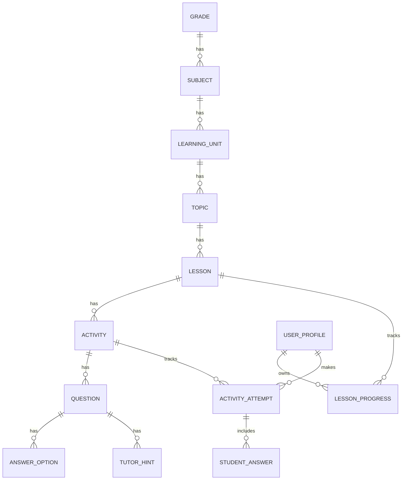

# AulaNexo — Especificación de implementación de contenidos de primer grado para Codex

**Versión:** 1.0  
**Estado:** Especificación de desarrollo propuesta  
**Producto:** AulaNexo (único nombre del aplicativo)  
**Plataforma:** Android, Kotlin, Jetpack Compose, Room, DataStore  
**Enfoque:** Offline First; estudiantes de primer grado de primaria (aprox. 6 años)  
**Documento de referencia:** Temario de primer grado proporcionado por el usuario, procedente de Web del Docente.

> **Importante:** El material de referencia enumera **214 temas** distribuidos en seis áreas, pero **no proporciona las fichas completas, sus actividades, imágenes ni una secuencia curricular oficial**. Este documento especifica cómo incorporar el temario a AulaNexo y propone actividades originales para un MVP. No debe interpretarse como validación de alineamiento curricular MINEDU. Los temas y su secuencia deben revisarse con un docente antes de considerarse currículo definitivo.

---

## 1. Instrucciones obligatorias para Codex

1. **Inspeccionar el repositorio antes de editar:** detectar la estructura real, dependencias, versión de Kotlin/Compose, navegación, base de datos, componentes y pantallas existentes. No sobrescribir trabajo previo.
2. **Mantener exclusivamente el nombre AulaNexo** en app, UI, documentación y recursos. No utilizar nombres alternativos presentes en borradores antiguos.
3. **Respetar el diseño UI existente:** fondo crema `#FFFDF0`, coral `#FF5252`, amarillo `#FFC107`, azul `#00A0E9`, tarjetas blancas o crema, esquinas 16–24dp, elevaciones suaves, botones grandes, tipografía infantil legible. Centralizar tokens en el tema Compose; no duplicar temas.
4. **Preservar y reutilizar** las pantallas ya implementadas. Adaptar el mapa de progreso, lector, panel de actividades y álbum de recompensas a seis áreas; no crear un segundo aplicativo.
5. **No depender de Internet** para abrir lecciones, realizar actividades, consultar progreso ni obtener pistas. No añadir APIs remotas ni permisos de red para funciones del MVP.
6. **No inventar recursos de las fichas originales:** el temario aporta títulos, no ejercicios ni medios reutilizables. Crear ejercicios **originales** y recursos locales propios para el MVP. Usar placeholders locales explícitos cuando falten ilustraciones o audio.
7. **No implementar los 214 temas como 214 pantallas:** utilizar datos y un motor de actividades reutilizable.
8. Trabajar **por fases**, mantener el proyecto compilable y ejecutar las pruebas disponibles. Reportar archivos modificados, comandos ejecutados, resultados y pendientes.
9. Si una decisión importante no puede inferirse del repositorio, documentar la suposición y solicitar confirmación antes de cambios destructivos o de alto alcance.

## 2. Objetivo funcional

Incorporar al aplicativo AulaNexo un **catálogo de primer grado** organizado en seis áreas, unidades, temas y lecciones; permitir que un estudiante seleccione una lección, resuelva actividades visuales offline, reciba pistas progresivas, guarde su progreso y desbloquee recompensas. El contenido inicial se distribuirá con la aplicación; posteriormente podrá importarse mediante paquetes `.aula` si el proyecto ya soporta ese formato.

### 2.1. Áreas del temario de referencia

| Código | Área | Temas de referencia |
|---|---|---:|
| MAT | Matemática | 45 |
| COM | Comunicación | 58 |
| CYA | Ciencia y Ambiente | 36 |
| PSO | Personal Social | 29 |
| RMA | Razonamiento Matemático | 26 |
| RVE | Razonamiento Verbal | 20 |
| **Total** | | **214** |

La separación de áreas refleja la fuente. No implica que sean seis áreas curriculares oficiales distintas.

### 2.2. Alcance MVP

- Catálogo local de **primer grado** con seis áreas.
- Una unidad introductoria por área, con al menos una lección funcional por unidad.
- Actividades originales de selección única, conteo, ordenación, asociación y formación de palabras, según corresponda.
- Pistas pedagógicas ordenadas; retroalimentación de errores.
- Guardado de progreso por perfil local y por lección.
- Recompensas sin duplicaciones.
- Estados vacíos y manejo de contenido/audio ausente.
- Pruebas de funcionamiento con modo avión.

**Fuera del MVP:** reconocimiento de voz con IA, generación remota de ejercicios, descarga obligatoria, sincronización en nube, creación de 214 fichas completas y edición avanzada de contenidos por docentes.

## 3. Catálogo completo de temas de referencia

Mantener los títulos originales como metadatos de referencia. **No interpretar el orden original como prerrequisitos pedagógicos validados.** Las unidades y el orden de enseñanza deberán definirse de forma independiente.

### 3.1. Matemática (45)

1. Nociones Espaciales
2. Desplazamientos en el Plano Cartesiano
3. Números del 1 al 9
4. Adición para Niños
5. Sustracción para Niños
6. Unidades y Decenas
7. Anterior y Posterior
8. Repasemos la Decena
9. Sumas y Restas
10. Noción de Conjunto
11. Tablero de Valor Posicional hasta la Decena
12. Líneas Abiertas y Cerradas
13. Figuras y Sólidos Geométricas
14. Sumas y Restas en la Recta Numérica
15. Números Ordinales
16. Series Ascendentes y Descendentes
17. Antes y Despues de un Número
18. Escritura de Números
19. Comparación de Números
20. Adición Llevando
21. Lectura de Números
22. Ejercicios de Sumas y Restas
23. Operaciones Combinadas de Suma y Resta
24. El Doble y la Mitad
25. Multiplicación por 2
26. Multiplicación por 3
27. Problemas con Sumas y Restas
28. Adiciones y Sustracciones
29. Sumas, Restas y Multiplicaciones
30. Números en el Tablero Posicional
31. Números Naturales hasta el 999
32. La Centena
33. Unidades de Longitud
34. Unidades de Tiempo
35. Sistema Monetario
36. Dividir entre 2
37. Escritura de Números hasta el 500
38. Multiplicación por 4
39. Sumas y Restas de Números de 3 Cifras
40. Series con Números de 3 Cifras
41. Comparación de Números de 3 Cifras
42. Problemas con Multiplicación
43. Mitad y Tercia
44. Lectura y Escritura de Números de 3 Cifras
45. Introducción a la Estadística

### 3.2. Comunicación (58)

1. Coordinación Motora Fina
2. Escribo Mi Nombre
3. Discriminación Auditiva
4. Sonido Inicial y Final
5. Las Vocales
6. Cantidad de Silabas
7. La Conjunción Y
8. Fonema M
9. Fonema P
10. Adivinanzas
11. Día del Libro
12. Letras y Sonidos
13. Fonema S
14. Fonema L
15. Las Rimas
16. La mayúscula y el Punto
17. Fonema N
18. Fonema D
19. Conocemos los Artículos
20. Fonema T
21. Fonema R
22. Los Diminutivos
23. Fonema RR
24. Descripción de Objetos y Animales
25. Fonema B
26. Descripción de Personas y Lugares
27. Fonema F
28. Creación de Adivinanzas
29. Fonema H
30. Género y Número del Sustantivo
31. Ca, Co, Cu, Que y Qui
32. Fonema V
33. Fonema G
34. El Verbo
35. Fonema CH
36. Fonema Ñ
37. Signos de Admiración e Interrogación
38. Fonema Z, Ce y Ci
39. El Adjetivo
40. Fonema J, Ge y Gi
41. La Coma
42. Fonema LL
43. Fonema K
44. La Diéresis
45. Fonemas Y, W y X
46. Uso de la Mayúscula
47. Sustantivos Propios y Comunes
48. Poemas, Adivinanzas y Trabalenguas
49. Palabras con BR y BL
50. Palabras con PR y PL
51. Creación de Cuentos
52. Palabras con CR y CL
53. Palabras Según el Número de Sílabas
54. Número y Género de los Sustantivos
55. Palabras con GL y GR
56. Adjetivos y Verbos
57. Palabras con FR y FL
58. Palabras con DR

### 3.3. Ciencia y Ambiente (36)

1. Nuestro Cuerpo
2. Las Articulaciones
3. El Rostro
4. Hábitos de Higiene
5. Sentidos de la Vista, Oído y Olfato
6. Sentidos del Gusto y Tacto
7. Cuidando los Sentidos
8. Proyecto Nuestro Propio Teléfono
9. Salud y Enfermedad
10. Las Vacunas
11. Los Huesos
12. Los Músculos
13. Órganos Principales del Aparato Digestivo
14. Los Dientes
15. Higiene Bucal
16. Clases de Alimentos
17. Hábitos Alimenticios
18. Proyecto Manos a la Obra
19. Órganos Principales del Aparato Respiratorio
20. Los Seres Vivos
21. Ciclo de vida de los Seres Vivos
22. La Planta y sus partes
23. Cuidado de las Plantas
24. Los Animales
25. Animales que tienen Huesos
26. Animales que no tienen Huesos
27. Proyecto Mi Granjita
28. Los Mamíferos
29. Las Aves
30. Los Peces
31. Utilidad de los Animales
32. Cuidado de los Animales
33. El Agua y sus Estados
34. El Aire y su Contaminación
35. El Suelo y sus Tipos
36. Proyecto de Mascaras

### 3.4. Personal Social (29)

1. Normas de Convivencia
2. Identidad Personal
3. Diferencia entre Varón y Mujer
4. Útiles de Aseo
5. Seguridad Personal
6. Seguridad Vial
7. Desastres Naturales
8. Defensa Civil
9. Los Miembros de la Familia
10. Árbol Genealógico de la Familia
11. Miembros de la Escuela
12. Instituciones de la Comunidad
13. Derecho y Deberes de los Niños
14. Medios de Transporte
15. Medios de Comunicación
16. Orientación Espacial
17. Nuestro Planeta Tierra
18. Los Movimientos de la Tierra
19. Límites y Movimientos del Perú
20. Las Regiones Naturales
21. Regiones Naturales del Perú
22. La Cultura Chavín
23. La Cultura Paracas
24. Leyendas sobre el Origen del Imperio Incaico
25. El Imperio Incaico
26. Organización del Imperio Incaico
27. Llegada de Colón a América
28. Llegada de Pizarro al Perú
29. Independencia del Perú

### 3.5. Razonamiento Matemático (26)

1. Secuencia por Color
2. Secuencia por Tamaño y Forma
3. Construimos Figuras
4. Contamos Figuras
5. Clasificamos Figuras
6. Series Numéricas hasta el 10
7. Actividades de Suma y Resta
8. Actividades de Ecuaciones
9. Series Numéricas hasta el 19
10. Semejanzas y Diferencias de Figuras
11. Simetría de Figuras
12. Anterior y Posterior de un Número
13. Seriación con Adición y Sustracción
14. Solucionamos Problemas
15. Sumas y Restas con Símbolos
16. Sumas en Pirámides
17. Sumas y Restas en el Tablero Posicional
18. Secuencia Lógica
19. Ordenamos Números
20. Sucesiones Decrecientes y Crecientes
21. Formamos Figuras
22. Completamos con Adición y Sustracción
23. Rompecabezas
24. Reproducimos Figuras
25. Pensamos y Respondemos
26. Series Numéricas

### 3.6. Razonamiento Verbal (20)

1. Percepción Visual
2. Sonido Inicial y Final
3. Percepción Visual con Letras
4. Formación de Palabras
5. Conceptos Verdaderos o Falsos
6. Elemento Extraño
7. Ordenando Oraciones
8. Semejanzas y Diferencias
9. Rompecabezas
10. Palabras Sinónimas
11. Mapas Conceptuales
12. Palabras Antónimas
13. Descripción de Objetos e Imágenes
14. Analogías para Niños
15. Oraciones Incompletas para Niños
16. Sopa de Letras
17. Descifrar Mensajes Ocultos
18. Crucigrama de Frutas y Verduras
19. Escritura Correcta
20. Vamos a Describir

## 4. Organización pedagógica propuesta para el MVP

Esta sección **es una propuesta nueva de implementación**, no una transcripción de fichas ni una secuencia oficial.

| Área | Unidad inicial | Tema fuente | Actividad original de ejemplo | Motor |
|---|---|---|---|---|
| COM | Descubro las vocales | Las Vocales | Elegir la vocal inicial de «oso» entre O, A, E | SINGLE_CHOICE |
| MAT | Cuento del 1 al 9 | Números del 1 al 9 | Contar 4 objetos y seleccionar 4 | COUNT_OBJECTS |
| RMA | Descubro patrones | Secuencia por Color | Completar rojo-azul-rojo-azul-__ | SEQUENCE |
| RVE | Escucho sonidos | Sonido Inicial y Final | Elegir qué palabra empieza con /m/ | SINGLE_CHOICE |
| CYA | Conozco mi cuerpo | Nuestro Cuerpo | Asociar «mano» con su ilustración | MATCH_PAIRS |
| PSO | Convivimos mejor | Normas de Convivencia | Elegir una acción respetuosa en clase | SINGLE_CHOICE |

Cada lección debe tener:
- `learningObjective` (objetivo observable).
- Instrucciones breves y comprensibles.
- Entre 3 y 5 ejercicios originales para el MVP.
- Al menos 2 pistas por ejercicio evaluable, cuando tengan sentido.
- Retroalimentación por respuesta.
- Regla de finalización explícita.
- Recursos locales o representación visual alternativa.

**Regla de desbloqueo MVP:** todas las seis unidades iniciales estarán disponibles. No bloquear áreas por errores o por falta de conectividad.

## 5. Requerimientos funcionales de implementación

| ID | Requerimiento | Prioridad |
|---|---|---|
| PR-001 | Mostrar primer grado en el catálogo de aprendizaje | Alta |
| PR-002 | Mostrar seis áreas con título, icono, progreso y estado | Alta |
| PR-003 | Mostrar unidades y lecciones de cada área | Alta |
| PR-004 | Abrir lecciones desde el mapa de aprendizaje | Alta |
| PR-005 | Mostrar actividades mediante un renderizador por tipo | Alta |
| PR-006 | Evaluar respuestas sin servicios remotos | Alta |
| PR-007 | Mostrar pistas progresivas sin revelar la respuesta en la primera pista | Alta |
| PR-008 | Guardar intentos y progreso por perfil | Alta |
| PR-009 | Reanudar una lección sin perder el avance confirmado | Alta |
| PR-010 | Otorgar recompensas sin duplicarlas | Media |
| PR-011 | Mostrar errores y estados vacíos comprensibles | Alta |
| PR-012 | Cargar el catálogo desde datos locales versionados | Alta |
| PR-013 | Registrar los 214 títulos como catálogo de referencia, diferenciando temas disponibles de los no implementados | Media |
| PR-014 | Permitir expansión a otros grados sin implementarlos ahora | Media |
| PR-015 | Mantener el progreso independiente entre perfiles | Alta |

### 5.1. Estados de contenido

- `CATALOG_ONLY`: el título figura en el temario, pero no tiene lección interactiva implementada.
- `AVAILABLE`: la lección tiene contenido y actividades utilizables.
- `IN_PROGRESS`: progreso individual iniciado.
- `COMPLETED`: completada según criterio definido.

No mostrar temas `CATALOG_ONLY` como si fueran lecciones listas para abrir. Pueden aparecer en una sección de próximos contenidos, claramente diferenciada, o quedar ocultos en la vista del estudiante.

## 6. Modelo de datos propuesto

**Antes de crear tablas:** revisar entidades existentes y extenderlas mediante migraciones. Los nombres siguientes son conceptuales, no una orden de duplicar clases.



### 6.1. Entidades mínimas

| Entidad | Campos esenciales |
|---|---|
| `Grade` | `id`, `number`, `label`, `sortOrder` |
| `Subject` | `id`, `gradeId`, `code`, `title`, `iconKey`, `sortOrder` |
| `LearningUnit` | `id`, `subjectId`, `title`, `description`, `sortOrder` |
| `Topic` | `id`, `unitId` (nullable para temas de referencia sin unidad), `subjectId`, `title`, `sourceOrder`, `contentStatus` |
| `Lesson` | `id`, `topicId`, `title`, `learningObjective`, `sortOrder`, `contentVersion` |
| `Activity` | `id`, `lessonId`, `type`, `instructions`, `sortOrder` |
| `Question` | `id`, `activityId`, `prompt`, `type`, `payloadJson`, `feedbackCorrect`, `feedbackIncorrect`, `sortOrder` |
| `AnswerOption` | `id`, `questionId`, `text`, `resourceKey`, `isCorrect`, `sortOrder` |
| `TutorHint` | `id`, `questionId`, `hintOrder`, `text` |
| `LessonProgress` | `profileId`, `lessonId`, `status`, `completedQuestions`, `totalQuestions`, `updatedAt`, `completedAt` |
| `ActivityAttempt` | `id`, `profileId`, `activityId`, `startedAt`, `completedAt`, `score` |
| `StudentAnswer` | `id`, `attemptId`, `questionId`, `answerPayloadJson`, `isCorrect`, `hintsUsed`, `answeredAt` |

**Restricciones:** índices y claves foráneas; `UNIQUE(profileId, lessonId)` para progreso; UUID o IDs estables para contenido; no usar títulos como claves. No guardar datos personales innecesarios. El contenido local debe tener versión y un proceso de actualización idempotente que no elimine el progreso.

### 6.2. JSON de ejemplo (contrato orientativo)

```json
{
  "schemaVersion": 1,
  "grade": 1,
  "subjectCode": "MAT",
  "unitId": "g1-mat-u1",
  "topicId": "g1-mat-t03",
  "lesson": {
    "id": "g1-mat-count-1-9",
    "title": "Cuento del 1 al 9",
    "learningObjective": "Contar colecciones de hasta nueve elementos",
    "contentVersion": 1,
    "activities": [
      {
        "id": "g1-mat-count-01",
        "type": "COUNT_OBJECTS",
        "instructions": "Cuenta los círculos y elige el número.",
        "questions": [
          {
            "id": "g1-mat-count-q01",
            "prompt": "¿Cuántos círculos hay?",
            "payload": { "symbol": "circle", "count": 4 },
            "options": [
              { "id": "o3", "text": "3", "isCorrect": false },
              { "id": "o4", "text": "4", "isCorrect": true },
              { "id": "o5", "text": "5", "isCorrect": false }
            ],
            "hints": [
              { "order": 1, "text": "Señala cada círculo mientras cuentas." },
              { "order": 2, "text": "Cuenta de uno en uno sin saltarte ninguno." }
            ],
            "feedbackCorrect": "¡Bien! Contaste todos los círculos.",
            "feedbackIncorrect": "Intenta contar otra vez, despacio."
          }
        ]
      }
    ]
  }
}
```

El JSON es una propuesta de contenido, **no un formato ya implementado**. Codex deberá adaptarlo al contrato real del repositorio. No exponer `isCorrect` desde los modelos de UI antes de evaluar.

## 7. Motor reutilizable de actividades

Definir una interfaz de evaluación por tipo, separando UI, evaluación y persistencia.

| Tipo | Entrada | Evaluación |
|---|---|---|
| `SINGLE_CHOICE` | ID de opción | Coincide con opción correcta |
| `COUNT_OBJECTS` | ID de opción o número | Coincide con cantidad esperada |
| `SEQUENCE` | Elemento siguiente | Coincide con patrón definido |
| `MATCH_PAIRS` | Pares de IDs | Coinciden todas las asociaciones |
| `WORD_BUILDING` | Secuencia de letras | Coincide con respuesta normalizada |

**Reglas:**
- No marcar un error como acierto por mostrar una pista.
- Guardar respuestas e intentos por separado.
- Permitir reintentar sin borrar intentos anteriores.
- Normalizar entradas textuales solo según reglas explícitas del ejercicio.
- Usar ilustraciones o símbolos grandes; no depender únicamente del color para responder.
- Si una actividad no puede renderizarse por un tipo desconocido, mostrar error recuperable, no cerrar la aplicación.

## 8. Tutor educativo offline

Implementar un motor determinista de pistas por pregunta:

1. Al primer error, mostrar retroalimentación que invite a volver a intentar.
2. Al solicitar ayuda, presentar `hintOrder=1`.
3. En solicitudes sucesivas, presentar pistas siguientes.
4. Si se agotan las pistas, comunicarlo con claridad sin inventar explicaciones.
5. Registrar `hintsUsed` y evitar duplicar pistas mostradas.

El tutor **no debe afirmar que es una IA generativa**. Puede describirse como asistente de aprendizaje basado en pistas. En el MVP, si detecta falta de contenido, debe reconocer la limitación.

## 9. Diseño y navegación

### 9.1. Rutas lógicas

```text
profile/select
learning/grades
learning/grade/{gradeId}/subjects
learning/subject/{subjectId}/units
learning/unit/{unitId}/lessons
learning/lesson/{lessonId}
learning/activity/{activityId}
learning/lesson/{lessonId}/result
rewards/album
progress/overview
```

Adaptar los nombres de rutas al proyecto existente. No crear navegación paralela si ya hay `NavHost`.

### 9.2. Pantallas existentes y adaptación

- **Mapa de aprendizaje:** mostrar grado, seis áreas y sus unidades; usar tarjetas grandes y estados visuales claros.
- **Lector interactivo:** reutilizarlo para lecciones con texto e ilustraciones; el audio debe ser opcional y local.
- **Panel interactivo:** alojar actividades de números, letras, secuencias, asociaciones y conteo mediante componentes por tipo.
- **Álbum de recompensas:** mantenerlo como recompensa transversal a las seis áreas.

### 9.3. Tokens visuales obligatorios

```text
brand_primary   #FF5252
brand_secondary #FFC107
brand_accent    #00A0E9
bg_app          #FFFDF0
card_bg_white   #FFFFFF
card_bg_warm    #FAF6E8
text_primary    #2C2C2C
text_secondary  #78909C
shadow_color    #E0D7C6
```

Usar Jetpack Compose y Material 3, radios 16–24dp, sombras suaves, tamaños táctiles accesibles y etiquetas de accesibilidad. Conservar la identidad visual y los componentes actuales.

## 10. Carga inicial y actualizaciones

1. Empaquetar un catálogo local versionado de **214 títulos** con área y orden de origen.
2. Empaquetar seis lecciones MVP con contenido y ejercicios originales.
3. Al iniciar, comprobar versión del catálogo; insertar/actualizar mediante claves estables y transacciones.
4. No borrar intentos ni progresos por actualizaciones de títulos o metadatos.
5. Marcar claramente como `CATALOG_ONLY` los títulos sin contenido implementado.
6. No depender de `assets` externos ni descargas para el primer uso.
7. Si existe importación `.aula`, integrarla con el catálogo; no rediseñar el formato de intercambio sin revisar la implementación existente.

## 11. Criterios de aceptación verificables

| ID | Prueba | Resultado esperado |
|---|---|---|
| AC-01 | Abrir en modo avión | El catálogo y las seis lecciones MVP funcionan |
| AC-02 | Ver primer grado | Aparecen las seis áreas |
| AC-03 | Abrir una unidad | Se muestran lecciones disponibles |
| AC-04 | Abrir tema sin contenido | No se presenta una pantalla de actividad vacía como si fuera funcional |
| AC-05 | Resolver conteo correctamente | Se registra acierto y progreso |
| AC-06 | Responder incorrectamente | Se muestra feedback y puede reintentarse |
| AC-07 | Solicitar dos pistas | Se muestran en orden sin repetir la anterior |
| AC-08 | Cerrar y reabrir | El progreso permanece |
| AC-09 | Cambiar de perfil | El progreso no se mezcla |
| AC-10 | Completar lección dos veces | No se duplica la recompensa única |
| AC-11 | Actualizar catálogo | No se pierden intentos ni progreso |
| AC-12 | Recurso de audio ausente | La lección continúa funcionando sin caída |
| AC-13 | Actividad con tipo desconocido | Se muestra un estado de error recuperable |
| AC-14 | Accesibilidad | Botones tienen etiquetas y tamaño táctil apropiado |
| AC-15 | Reinstalar datos semilla idempotentes | No aparecen temas duplicados |

## 12. Pruebas automatizadas requeridas

- Unit tests del evaluador de cada tipo de actividad.
- Unit tests de progresión y agotamiento de pistas.
- Unit tests de cálculo de progreso y recompensas.
- Pruebas Room de relaciones, migraciones e idempotencia del seed.
- Pruebas de UI para navegación grado → área → unidad → lección.
- Prueba de separación de progreso por perfil.
- Prueba manual en dispositivo real con modo avión, reinicio de app y recursos faltantes.

## 13. Orden de ejecución para Codex

### Fase 0 — Auditoría del repositorio

- Inspeccionar estructura y funcionalidades existentes.
- Identificar modelos, pantallas y navegación reutilizables.
- Presentar un plan breve de archivos a crear/modificar.
- Identificar conflictos entre la especificación y el código actual.

**Entregable:** plan técnico y lista de decisiones, sin cambios destructivos.

### Fase 1 — Catálogo y datos

- Modelar grado, área, unidad, tema y lección reutilizando entidades existentes.
- Añadir migraciones y DAOs necesarios.
- Cargar 214 títulos como catálogo de referencia y seis lecciones originales.
- Probar idempotencia y persistencia.

**Entregable:** catálogo consultable desde repositorios.

### Fase 2 — Navegación y UI

- Integrar grado y seis áreas al mapa existente.
- Mostrar unidades, lecciones, estados y progreso.
- Mantener el diseño visual de AulaNexo.

**Entregable:** navegación completa sin actividades falsas.

### Fase 3 — Motor de actividades y tutor

- Implementar renderizadores para tipos requeridos.
- Implementar evaluación, feedback y pistas progresivas.
- Añadir las actividades de las seis lecciones MVP.

**Entregable:** actividades funcionales sin Internet.

### Fase 4 — Progreso, recompensas y calidad

- Persistir intentos, progreso y recompensas.
- Añadir pruebas automatizadas y ejecutar validación offline.
- Corregir errores y actualizar documentación del repositorio.

**Entregable:** flujo completo demostrable y compilable.

## 14. Formato de reporte al finalizar cada fase

Codex debe entregar:

```text
Fase completada:
Resumen de implementación:
Archivos creados:
Archivos modificados:
Migraciones aplicadas:
Pruebas ejecutadas y resultados:
Comando de compilación y resultado:
Limitaciones conocidas:
Siguiente fase sugerida:
```

Si no puede ejecutar una prueba o compilar por falta de SDK, emulador u otra dependencia, debe indicarlo expresamente; **no afirmar que se validó lo que no se ejecutó**.

## 15. Prompt de ejecución para Codex

> Lee íntegramente `docs/AulaNexo_Implementacion_Primer_Grado_Codex.md` y el documento de diseño UI existente. Tu tarea es implementar el catálogo y el MVP de contenidos de primer grado dentro del aplicativo Android **AulaNexo**, conservando el código actual, la arquitectura y el diseño visual. Primero audita el repositorio y entrega un plan de implementación con los archivos afectados y posibles conflictos. No crees un proyecto nuevo ni cambies el nombre del aplicativo. Después implementa por fases, compilando y probando cada incremento. El catálogo fuente contiene 214 títulos, pero solo seis lecciones iniciales deben tener actividades originales completas en el MVP. No inventes fichas ni recursos de terceros; mantén el funcionamiento offline y el progreso independiente por estudiante.

---

## 16. Notas para validación pedagógica posterior

- Contrastar la secuencia con el Currículo Nacional y orientaciones vigentes del MINEDU antes de su despliegue escolar.
- Revisar especialmente los temas de multiplicación, división, números de tres cifras e historia, pues su inclusión en la colección no prueba que deban enseñarse en el MVP de primer grado.
- Evitar confundir el reconocimiento de letras y sonidos en español con un programa de fonética inglesa: el temario proporcionado está redactado en español y las actividades iniciales aquí propuestas se orientan al aprendizaje en español.
- Validar instrucciones y nivel de dificultad con docentes y estudiantes.
- Revisar derechos de uso de fichas, imágenes y audios antes de incorporar material ajeno; los títulos del temario sirven como referencia temática.
